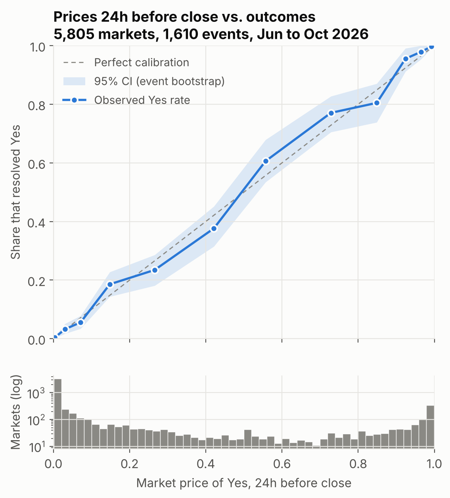
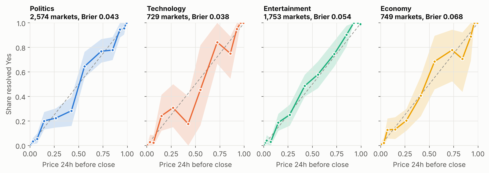
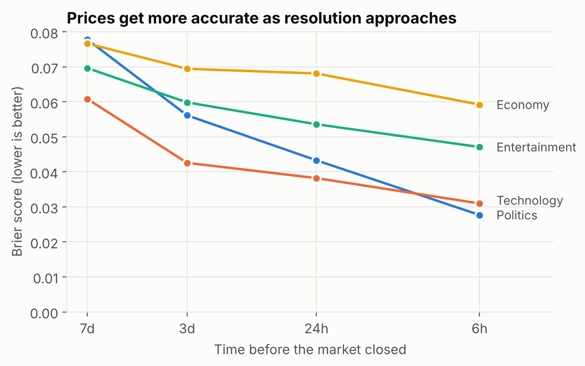
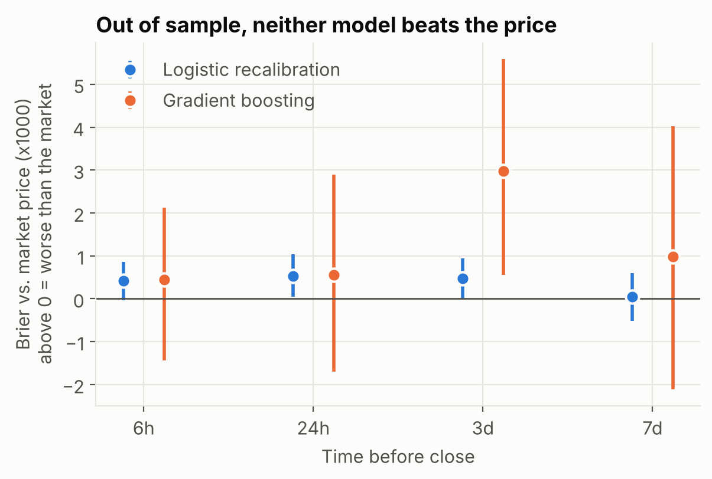
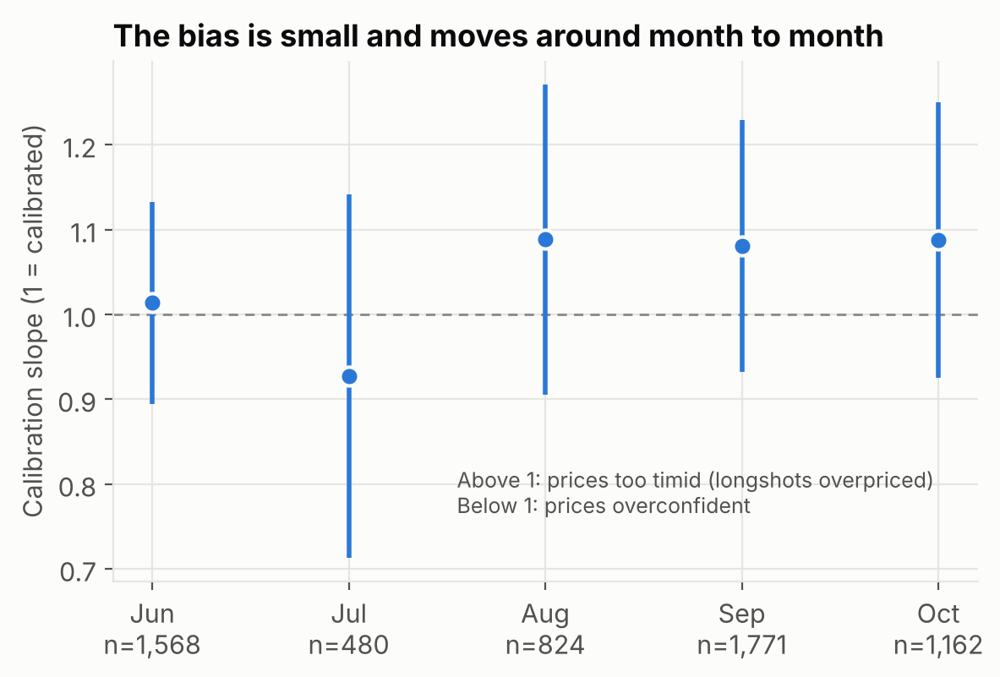

# Market calibration: can a model beat the crowd?

STATS C161 midterm, market part. Author: Aaron. Last updated Oct 27, 2026.

**Short answer.** Polymarket prices are well calibrated in all four project categories. A faint
favorite-longshot pattern shows up near the close, but only at extreme prices, and it changes direction
from month to month. Neither a re-calibration model nor gradient boosting with 18 extra features beats the
raw price out of sample. For the final this means: the price is a strong baseline, so an informed trader is
someone whose bets beat the price they paid, not someone who simply wins a lot.

Every number below is in `reports/tables/key_numbers.json`, written by `scripts/run_market_analysis.py`.
If a number here and that file ever disagree, the file is right. Rebuild everything with `make market`.

Contents: [1 Question](#1-question) · [2 Data](#2-data) · [3 Methods](#3-methods-and-why) ·
[4 Results](#4-results) · [5 Robustness](#5-robustness) · [6 Limitations](#6-limitations) ·
[7 Link to the final](#7-link-to-the-final) · [8 Reproduce](#8-reproduce) · [9 Files](#9-files)

---

## 1. Question

A Yes share pays $1 if the event happens and $0 if not. If a trader believes the chance is p and the share
costs c, the expected profit of buying one share is

    E[profit] = p(1 - c) + (1 - p)(0 - c) = p - c

so traders buy while p > c and sell while p < c, and the price settles near the crowd's belief. That makes
the price a probability forecast we can grade against outcomes.

Two questions:

1. **Is the price calibrated?** When the market says 30%, does it happen 30% of the time? In particular, is
   there a favorite-longshot bias (long shots overpriced, favorites underpriced), the classic finding in
   horse-race betting?
2. **Can a model beat it?** Using only information available at the time, can we produce better
   probabilities than the price?

## 2. Data

| Source | What we use | Where |
| --- | --- | --- |
| Course Postgres catalog | markets, events, resolutions (who won, when it closed) | `data/raw/catalog/` |
| Polymarket public API (Gamma) | event category tags | `data/raw/catalog/event_tags.parquet` |
| Course wallet trade files | every fill with time, side, outcome, price | `data/raw/wallet_trades/` (local only, 3.1 GB) |
| Course hourly order book | best bid/ask per token per hour, used as a check | `data/processed/hourly_book/` |

**Sample.** Resolved Yes/No markets whose event carries one of Polymarket's tags `politics`, `tech`,
`pop-culture` (our Entertainment) or `economy`, closing between Jun 1 and Oct 25, 2026. The course catalog
has no category field, which is why we use Polymarket's own tags. An event with two of our tags goes to the
rarer one (a Fed-chair event counts as Economy, not Politics). Markets that share a condition id are aliases
of one contract and are kept once. Result: **7,479 markets**.

**Price at each time point.** For each market and each horizon h in {6h, 24h, 3 days, 7 days} we take the
moment h hours before the market closed and read the **last trade before it**, converting No trades to the
Yes side with 1 - price. A last trade older than 72 hours does not count as a price. We first tried the
hourly order book, but its recorder only captured **22%** of these markets. Where both exist at the same
moment, trade price and book midpoint agree closely: **correlation 0.92, median gap 0.9 cents**
(2,915 rows).

| Horizon | Markets with a price | Events | Share resolved Yes |
| --- | --- | --- | --- |
| 6h | 5,919 | 1,628 | 21% |
| 24h | 5,805 | 1,610 | 20% |
| 3d | 5,645 | 1,561 | 19% |
| 7d | 4,178 | 1,265 | 20% |

Most markets sit in multi-outcome events (one market per candidate, film, date), so many are long shots
priced near zero. See the histogram under figure 1.

## 3. Methods and why

**Brier score** = mean of (price - outcome)², lower is better. It and log loss are *proper scoring rules*:
a forecaster gets the best expected score only by reporting what they actually believe, so neither can be
gamed by shading toward 0, 1 or 50%. Accuracy would not do: it treats 51% and 99% as the same call.

**Calibration curve.** Group markets into price bins (0-2c, 2-5c, ..., 98-100c) and plot each bin's mean
price against the share that resolved Yes. A calibrated market lies on the diagonal.

**Calibration slope.** One number for the same idea: fit the logistic regression

    P(Yes) = 1 / (1 + exp(-(a + b * logit(price))))

- b = 1: calibrated
- b > 1: prices too timid, squeezed toward 50%. Long shots are overpriced and favorites underpriced, which is
  the favorite-longshot bias.
- b < 1: prices overconfident

Prices are clipped to [0.005, 0.995] before the logit.

**Confidence intervals resample whole events.** Markets in one event are dependent: in a "Best Picture"
event exactly one of ten markets resolves Yes. Treating rows as independent would make intervals far too
narrow, so every bootstrap (300 draws) resamples events, and the regressions in section 5 use
event-clustered standard errors.

**No leakage.**
- Every feature uses only trades before the time point.
- Train = events whose markets all closed before Sep 1, 2026 (841 events, 3,215 markets). Test = all other
  events (860 events, 3,511 markets). An event never sits on both sides.
- The catalog's volume and last-price fields are snapshots taken after the fact, so they are not used.

**Models.**
- *Market price*: the baseline; the price itself is the probability.
- *Logistic recalibration*: logit(price), its interaction with log(horizon), and category intercepts and
  slopes. It learns a correction to the price.
- *Gradient boosting* (scikit-learn `HistGradientBoostingClassifier`, 300 trees, learning rate 0.05,
  15 leaves, at least 40 rows per leaf): logit(price) plus 18 features known at the time. These are the
  24h volume-weighted price, 24h price change and volatility, the share of 24h dollars pushing toward Yes,
  24h and cumulative dollars, fills and distinct wallets in 24h, hours since the last trade, market age,
  days to the scheduled end, multi-outcome flag, number of markets in the event, and category.

**Comparison.** For each model, Brier minus market Brier on the test set, with an event-bootstrap 95%
interval. Above zero means worse than the market.

**Feature importance.** Permutation importance: shuffle one feature and measure how much the test Brier
gets worse.

## 4. Results

### 4.1 Prices are well calibrated



Across 5,805 markets a day before close, the observed Yes rate tracks the price within the 95% band almost
everywhere.



The same holds in each category. Technology and Economy have the widest bands because they have the fewest
markets.

### 4.2 Accuracy over time and by category



| Brier score | 6h | 24h | 3d | 7d |
| --- | --- | --- | --- | --- |
| All | 0.038 | 0.049 | 0.057 | 0.074 |
| Politics | 0.028 | 0.043 | 0.056 | 0.078 |
| Technology | 0.031 | 0.038 | 0.043 | 0.061 |
| Entertainment | 0.047 | 0.054 | 0.060 | 0.070 |
| Economy | 0.059 | 0.068 | 0.069 | 0.077 |

Accuracy roughly doubles between 7 days and 6 hours before close, as information arrives. Politics improves
the most. From 3 days out to the close, Economy is the hardest category to call.

### 4.3 Calibration slopes

| Horizon | Slope, all prices (95% CI) | Slope, 2c to 98c only (95% CI) |
| --- | --- | --- |
| 6h | 1.08 (1.01 to 1.16) | 1.00 (0.89 to 1.11) |
| 24h | 1.05 (0.99 to 1.13) | 1.01 (0.92 to 1.11) |
| 3d | 1.04 (0.97 to 1.11) | 1.04 (0.95 to 1.13) |
| 7d | 0.95 (0.88 to 1.03) | 0.95 (0.86 to 1.04) |

By category at 24h: Politics 1.03 (0.95 to 1.15), Technology 1.11 (0.98 to 1.29), Entertainment 1.12
(1.00 to 1.29), Economy 0.92 (0.77 to 1.14). Only Entertainment's interval sits just above 1. With four
categories tested, one borderline result is not unusual by chance.

### 4.4 No model beats the price



Test set, all prices:

| Horizon | Model | Brier | Log loss | AUC | Brier minus market (95% CI) |
| --- | --- | --- | --- | --- | --- |
| 6h | Market price | 0.0410 | 0.134 | 0.983 | |
| 6h | Logistic recalibration | 0.0415 | 0.137 | 0.981 | +0.0004 (0.0000 to 0.0009) |
| 6h | Gradient boosting | 0.0415 | 0.138 | 0.982 | +0.0004 (-0.0014 to 0.0021) |
| 24h | Market price | 0.0513 | 0.170 | 0.971 | |
| 24h | Logistic recalibration | 0.0518 | 0.173 | 0.970 | +0.0005 (0.0000 to 0.0010) |
| 24h | Gradient boosting | 0.0518 | 0.174 | 0.970 | +0.0006 (-0.0017 to 0.0029) |
| 3d | Market price | 0.0558 | 0.187 | 0.962 | |
| 3d | Logistic recalibration | 0.0563 | 0.190 | 0.959 | +0.0005 (0.0000 to 0.0009) |
| 3d | Gradient boosting | 0.0588 | 0.197 | 0.958 | +0.0030 (0.0006 to 0.0056) |
| 7d | Market price | 0.0783 | 0.262 | 0.923 | |
| 7d | Logistic recalibration | 0.0784 | 0.261 | 0.921 | +0.0001 (-0.0005 to 0.0006) |
| 7d | Gradient boosting | 0.0793 | 0.265 | 0.922 | +0.0010 (-0.0021 to 0.0040) |

Neither model is better than the price at any horizon. Re-calibration is slightly worse at every horizon
(its interval touches zero at 6h, 3d and 7d), and boosting is clearly worse at 3 days. Restricting to prices between 5 and 95 cents does not change this: at 24h
the market's Brier is 0.148 against 0.150 for both models.

Permutation importance (increase in test Brier when shuffled): logit(price) 0.101, 24h weighted price 0.040,
days to scheduled end 0.002, everything else below 0.002. The model leans almost entirely on the price.

## 5. Robustness

**The slope above 1 comes from extreme prices.** Section 4.3: with all prices the 6h slope is 1.08 and its
interval just excludes 1. Drop prices under 2c or over 98c and it is 1.00. The logit stretches near-certain
prices, so a few of them can tilt the slope.

**It does not hold still.**



At 24h the monthly slope moves between 0.93 and 1.09, and every interval crosses 1. A pattern that changes
direction cannot be learned on summer data and used in autumn. That is the reason the models in 4.4 fail.

**Trade price vs order book.** Correlation 0.92, median gap 0.9 cents where both exist (section 2).

## 6. Limitations

1. **Early resolution.** Many "by date" markets close the moment the event happens (Yes), while No markets
   close on their deadline. So "24h before close" is just before the news for early Yes markets, and a
   fixed calendar point for No markets. Splitting the two groups is the natural next check.
2. **One test period** (Sep to Oct 2026).
3. **Trade price, not quote.** The last trade can be stale or small. The 72h staleness cut and the order-book
   check limit this, but do not remove it.
4. **Category tags are Polymarket's**, fetched on Oct 26, 2026, and an event with two tags is assigned to one.
5. **Recorder gaps.** The course order book has known gaps (Jun 16 to 19, Aug 25 to 31, Sep 14). They affect
   only the order-book check, not the trade prices.

## 7. Link to the final

The final asks for insider or informed trading detection. This study gives two things to build on:

- **A baseline.** Because the price is well calibrated, "this wallet won a lot" is not evidence: buying at 95c
  wins 95% of the time. The test is whether a wallet's bets beat the price it paid, e.g. the mean of
  (outcome - price paid) over its buys, compared with what chance would give.
- **A sample and code.** `data/processed/market_sample.parquet` and `src/market_analysis.py` already join
  markets, categories, outcomes and prices. Wallet-level work (Jiahong's part) can reuse the same market set.

## 8. Reproduce

```
pip install -r requirements.txt
make market            # tables, figures and the executed notebook, from the committed sample (~2 min)
make market-from-raw   # also rebuilds the sample; needs the raw wallet trades in data/raw/wallet_trades/
```

All randomness is seeded (`SEED = 0` in `src/market_analysis.py`). Two runs give byte-identical tables. The
category tags were pulled once and committed, so reruns do not depend on the live API.

## 9. Files

| Path | What it is |
| --- | --- |
| `src/market_analysis.py` | all analysis code: calibration, robustness, models, metrics |
| `scripts/fetch_event_tags.py` | category tags from the Polymarket API |
| `scripts/build_market_sample.py` | builds the market x horizon sample from catalog + trades |
| `scripts/run_market_analysis.py` | writes every table in `reports/tables/` |
| `scripts/make_market_figures.py` | writes `reports/figures/fig1` to `fig5` |
| `notebooks/01_market_calibration.ipynb` | executed walk-through of the same steps |
| `data/processed/market_sample.parquet` | the sample (29,916 market x horizon rows) |
| `reports/tables/key_numbers.json` | every number quoted in the slides |
| `reports/midterm/slide_script.md` | 7-minute slide script, backup slides, Q&A |
