# Wallet purchase price analysis

Research question: How well do wallet trading characteristics predict average purchase price, and does gradient boosting improve prediction over linear regression?

Gradient boosting predicts average purchase price more accurately than the linear model in this dataset. On 11,191 held out wallets, its mean absolute error is 16.74 cents per share, compared with 19.78 cents for linear regression and 22.14 cents for a constant mean prediction. The improvement over linear regression is 15.4%.

| Model | Test MAE cents | Test RMSE cents | Test R squared |
| --- | --- | --- | --- |
| Mean baseline | 22.14 | 27.17 | -0.0002 |
| Linear regression | 19.78 | 24.36 | 0.1965 |
| Gradient boosting | 16.74 | 21.61 | 0.3677 |

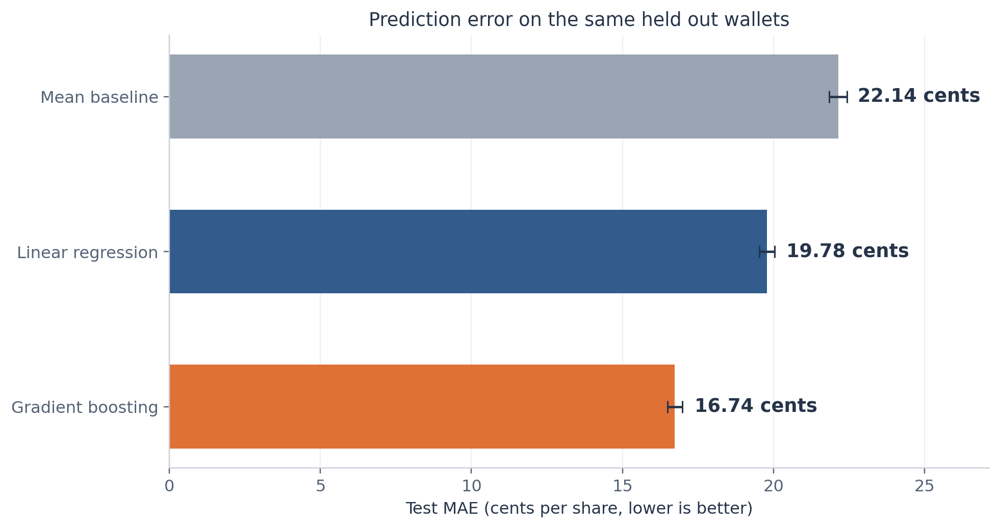

Figure 06. Primary models evaluated on identical test wallets. Error bars are 95% paired wallet-bootstrap intervals conditional on the fitted models. Each wallet has equal weight.

We retain all 55,952 wallets and use six predictors. The confirmed flag plays no role in data loading, modeling, evaluation, or interpretation. The analysis describes prediction across wallets using summaries from the same trading period. It does not establish future forecasting ability, causal effects, profitability, or trading skill.

Prepared October 26 2026. All reported model results come from the supplied feature table. The accompanying figure gallery provides all 15 figures as separate PNG and SVG files.

## Data scope and variable definitions

The course notebook describes a cohort of wallets that bought shares in five selected event groups between April 2025 and March 2026: US strikes on Iran, a US and Iran ceasefire, the Machado Nobel Peace Prize, Maduro leaving office, and the OpenAI browser. Wallet features summarize their observed history in the lab trade files. These wallets form a selected cohort rather than a random sample of every platform user. [R1, R2]

| Field | Meaning | Unit |
| --- | --- | --- |
| avg_buy_price | Volume weighted average price paid for purchased shares. This is the prediction target. | Dollars per share |
| trade_count | Recorded trading activity count. | Count |
| unique_markets | Number of distinct markets traded. | Count |
| wallet_age_days | Time between the first and last observed trade. This measures activity span rather than account creation age. | Days |
| concentration | Largest share of the wallet spending allocated to one market. A value of one means all spending goes to one market. | Proportion |
| total_notional | Total recorded spending. | Dollars |
| max_single_buy | Dollar value of the largest single purchase. | Dollars |

Each row represents one pseudonymous wallet. Wallet IDs serve only to check uniqueness and preserve split membership. Each wallet receives equal weight in model fitting and evaluation. The target uses volume weights within a wallet, while the study metrics use equal weights across wallets.

| Data check | Result |
| --- | --- |
| Rows and unique wallets | 55,952 each |
| Missing or nonfinite selected numeric values | 0 |
| Duplicate wallet IDs | 0 |
| Rows excluded | 0 |
| Wallets with one market | 3,834 |
| Wallets with zero observed span | 1,184 |

The source has 11 columns. We load only the wallet ID, target, and six predictors. We exclude market_notional_ratio to keep the agreed specification focused. We exclude position_anomaly_ratio because its definition reuses largest purchase, spending, and market count. Neither exclusion depends on test performance.

## Data checks and preparation

We check unique wallet IDs, complete finite numeric values, target prices between zero and one, and nonnegative inputs. We also check that market count does not exceed trade count, the largest purchase does not exceed total spending, and concentration is at least the inverse of the market count within rounding tolerance. All checks pass. No imputation, deduplication, winsorization, or outlier removal is necessary.

We apply the natural logarithm of one plus the original value to trade count, market count, observed span, total spending, and largest purchase. This keeps zero spans valid and reduces the influence of long right tails. Concentration stays on its original scale. We leave the target on its original dollar scale.

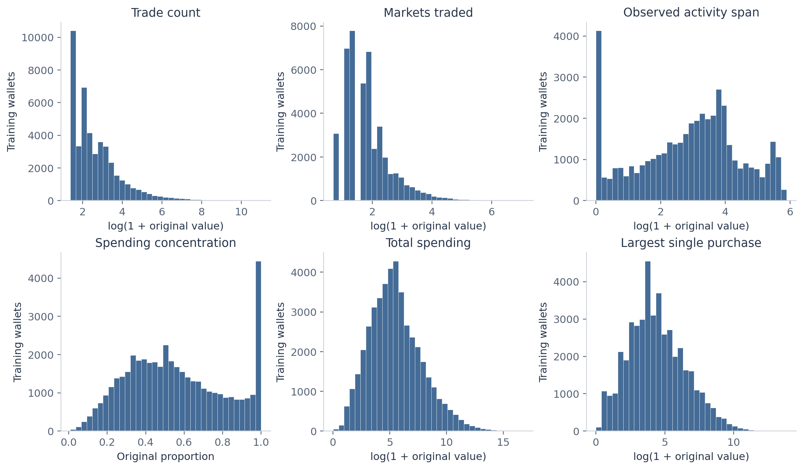

Figure 02. Five nonnegative predictors use log(1+x). Concentration remains on its original scale. No trimming or winsorization.

The linear model then standardizes each transformed predictor using means and standard deviations learned from its training fold. The boosting model uses the same transformed inputs without standardization. Log transformations mainly help the linear specification. Every fitted preprocessing step stays inside the model pipeline. [R6]

All wallets remain in the study, including those that satisfy the demo activity threshold. That threshold defines a supplementary error subgroup only. We make no claim that high activity proves automated trading.

## Model design and evaluation

### Training and test design

We randomly assign 80% of wallets to training and 20% to a final test set, using seed 42. This yields 44,761 training wallets and 11,191 test wallets with no ID overlap. The same split applies to every model. Within the training set, five shuffled folds with seed 42 provide validation errors. All model settings and supplementary specifications are fixed before test evaluation. [R4]

### Three primary comparisons

The mean baseline assigns every test wallet the training target mean, 0.668457 dollars per share. Linear regression fits an intercept and six additive terms using ordinary least squares on the transformed and standardized predictors. Histogram gradient boosting adds small regression trees sequentially, allowing nonlinear patterns and interactions. Both learned models fit squared error. We choose the boosting configuration using validation MAE. [R3]

| Boosting setting | Rule |
| --- | --- |
| Learning rate | 0.06 |
| Boosting iterations | 250 |
| Minimum wallets per leaf | 30 |
| Maximum histogram bins | 255 |
| Maximum leaves searched | 7, 15, 31 |
| L2 regularization searched | 0, 1 |
| Early stopping | Disabled |
| Selection criterion | Lowest mean validation MAE across five folds |

### Performance measures

MAE is the average absolute difference between observed and predicted price and is the primary measure. RMSE gives extra weight to large errors. Multiplying either by 100 expresses the error in cents per share. R squared compares squared errors with the variation around the test target mean. A small negative baseline R squared can occur because its prediction uses the training mean rather than the test mean.

We report primary predictions without clipping. We quantify MAE uncertainty with 2,000 paired bootstrap resamples of test wallets using seed 2026. Each resample preserves the pairing of errors across models. These intervals condition on the fitted models and assume wallet independence. They do not include training uncertainty or dependence among wallets sharing markets.

## Distribution of the prediction target

The target spans 0.001 to 0.999 dollars per share. In training, the mean is 0.668 and the median is 0.732. The distribution has substantial mass toward higher prices and a smaller group at low prices. A constant mean therefore misses meaningful differences between wallets.

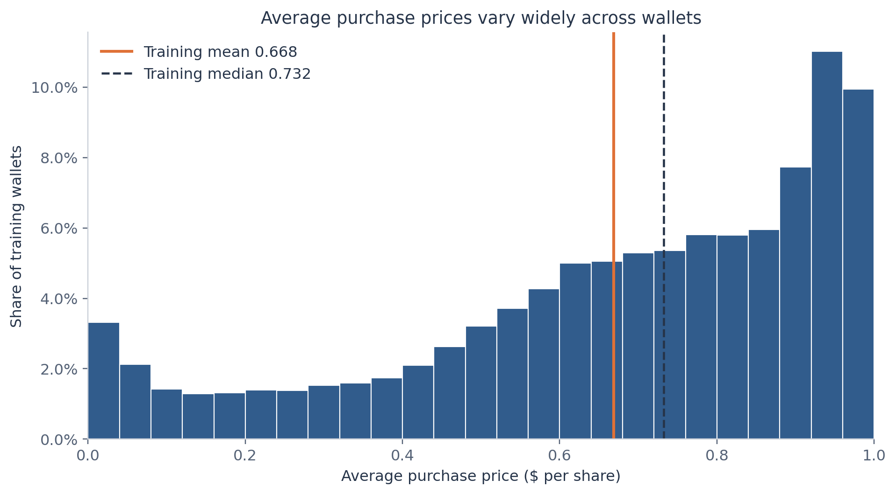

Figure 01. Training wallets only. Each wallet receives equal weight. Prices summarize shares bought across different markets.

| Split | Wallets | Mean price | Median price | Price SD |
| --- | --- | --- | --- | --- |
| train | 44,761 | 0.668 | 0.732 | 0.273 |
| test | 11,191 | 0.672 | 0.735 | 0.272 |

We inspect development distributions using training wallets. The split summary documents that the final test prices are broadly comparable, and it does not guide model changes. No wallet receives a weight based on total spending, so a small number of large accounts cannot dominate the reported error.

A lower average purchase price can reflect which markets and outcomes a wallet trades, or when it trades within those markets. Without market identities, resolutions, or trade timestamps, the target cannot identify bargain purchases, realized returns, or a preference for successful outcomes.

## Relationships among predictors

Training rank correlations show strong overlap among several predictors. Total spending and largest purchase have a correlation of about 0.95. Trade count and market count have a correlation of about 0.79. Market count and concentration have a correlation of about minus 0.73. These relationships matter when interpreting coefficients and feature importance.

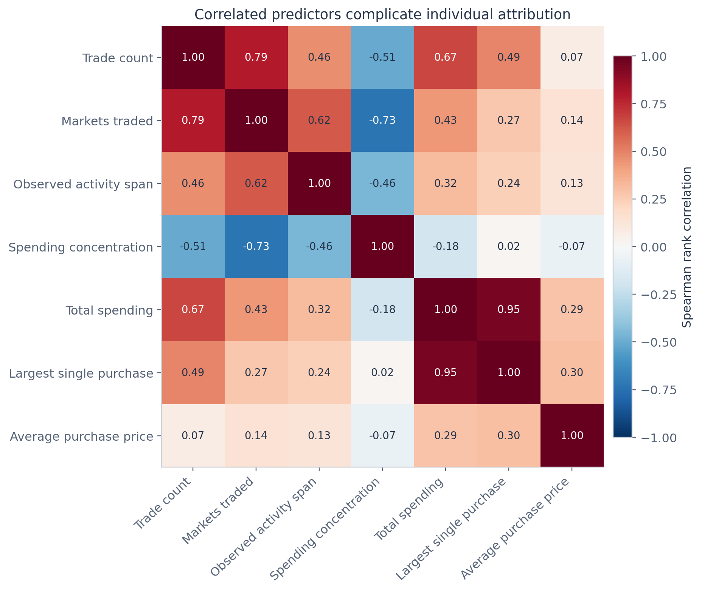

Figure 03. Training data only. Rank correlations summarize monotonic relationships and do not establish causation.

Individual monotonic correlations with average price are modest. Trade count has a rank correlation near 0.07 with the target, even though shuffling it later causes the largest increase in boosting error. Marginal correlation and predictive importance answer different questions. A weak one-variable association can still contribute to predictions alongside other inputs.

Concentration also has a structural relationship with market count: it cannot fall below one divided by the number of markets. We therefore avoid treating a concentration and market-count correlation as a separate behavioral discovery.

## Observed price patterns across wallets

We divide each training predictor into approximately equal-frequency bins and summarize average prices within each bin. The monetary predictors generally show higher observed prices in higher spending bins, while activity measures show curves that rise and then flatten. These plots motivate a flexible comparison but do not determine a causal effect or isolate a predictor from the others.

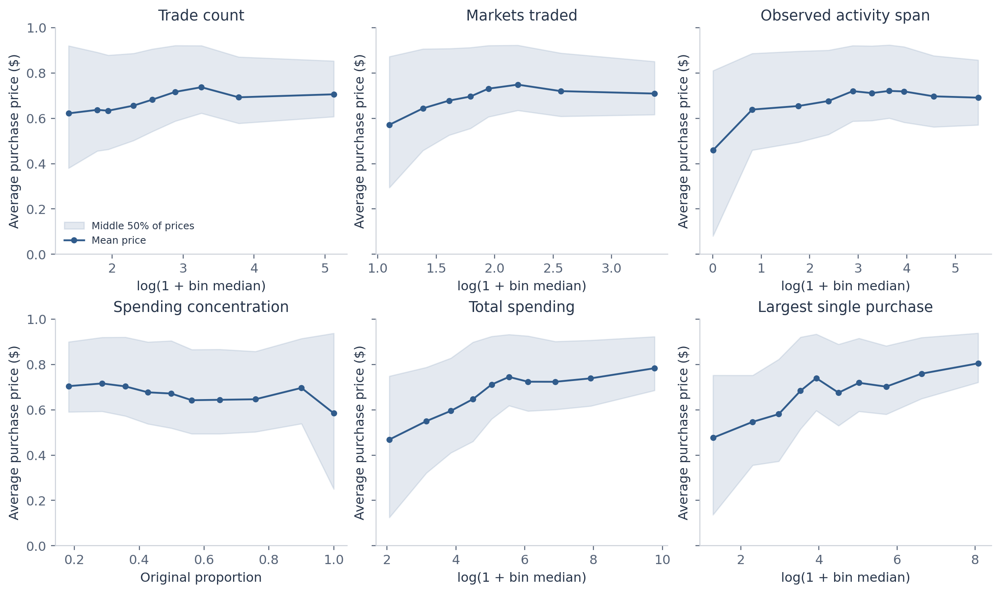

Figure 04. Training wallets in approximately equal-frequency bins. Shading shows the interquartile range of observed prices, not a confidence interval. Discrete predictors can produce fewer than ten bins.

The shaded ranges contain the middle half of observed wallet prices within each bin. Their width shows substantial variation among wallets with similar predictor values. They are not confidence intervals for the plotted means. Discrete counts can create repeated quantile boundaries, so some panels have fewer than ten bins.

These summaries average over differences in all other wallet characteristics. They can therefore differ from conditional linear coefficients. For example, the marginal relation with trade count is slightly positive, while the fitted linear coefficient becomes negative after accounting for spending, market count, span, and concentration. That sign change should not be read as evidence that trading more causes lower prices.

## Training validation and the final comparison

The boosting search compares six combinations of maximum leaves and L2 regularization on the same five training folds. Both the full and activity-only searches select 31 leaves with L2 regularization of one. The search is intentionally modest. The selected model is the best candidate within this grid rather than a globally optimized algorithm.

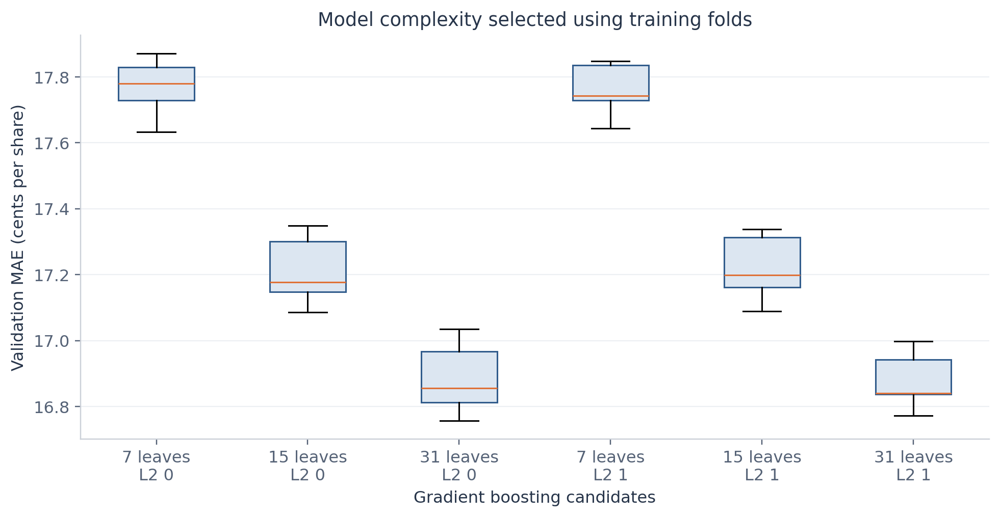

Figure 05. Five validation-fold errors per candidate. The search varies maximum leaves and L2 regularization while keeping other settings fixed. Fold variability is not a confidence interval.

| Primary model | Mean validation MAE cents | Fold SD cents | Final test MAE cents |
| --- | --- | --- | --- |
| Mean baseline | 22.22 | 0.05 | 22.14 |
| Linear regression | 19.87 | 0.17 | 19.78 |
| Gradient boosting | 16.88 | 0.09 | 16.74 |

Validation and test errors are similar, which supports the comparison within this cohort. Boosting training MAE is 16.04 cents, below its test MAE of 16.74 cents. This gap is consistent with some training optimism. We make no further model changes after reviewing the test diagnostics.

| MAE reduction from boosting | Estimate cents | 95 percent paired interval |
| --- | --- | --- |
| Relative to mean baseline | 5.41 | 5.15 to 5.66 |
| Relative to linear regression | 3.04 | 2.86 to 3.23 |

The paired comparison supports an improvement on these held out wallets under the bootstrap assumptions. The result does not show that a similar gain will hold for later periods, different events, or groups of dependent wallets.

## Predictions and residual patterns

The observed-versus-predicted plots show where each model approximates the target and where predictions move toward the middle. Boosting spreads predictions more flexibly, but both models still make sizable individual errors. The diagonal marks perfect prediction. The displayed axes emphasize the target range.

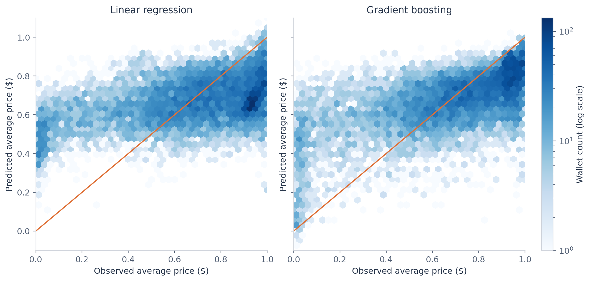

Figure 07. Test wallets. The diagonal represents perfect prediction. Predictions remain unclipped for the primary evaluation.

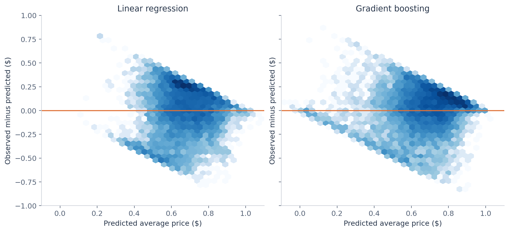

Figure 08. Test wallets. Positive residuals mean underprediction. The bounded target naturally constrains the residual envelope.

Residuals equal observed minus predicted price. A positive residual means the model predicts too low. Because prices have lower and upper bounds, residual plots naturally have a constrained envelope. We report unclipped predictions and address the small number outside zero to one in the sensitivity section.

## The size and location of prediction errors

Boosting predicts 19.4% of test wallets within five cents, 38.3% within ten cents, and 68.6% within twenty cents. These figures put the average error in context. A lower error than the baseline still leaves substantial uncertainty for an individual wallet.

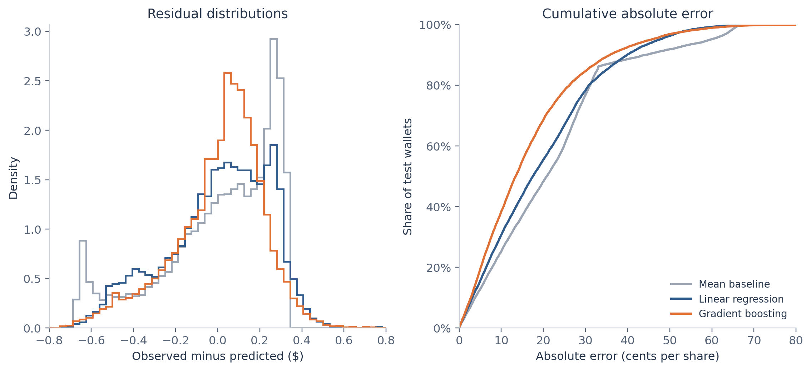

Figure 09. Test wallets. The cumulative curve gives the proportion of wallets predicted within a specified absolute error.

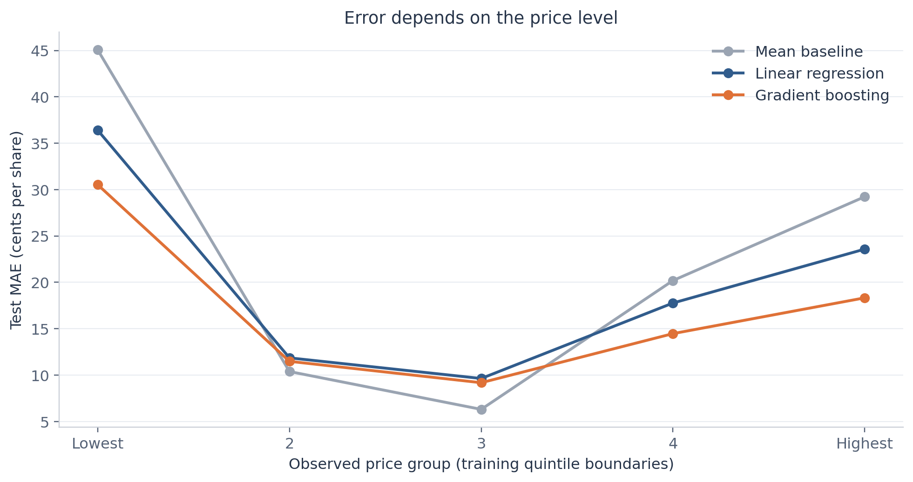

Figure 11. Test groups use price quintile boundaries fixed from the training set. Group membership uses the observed target and is descriptive only.

Price-group boundaries come from training quintiles. Grouping the test wallets by their observed target helps describe where errors occur, but those target groups are unavailable before prediction. They cannot serve as prospective inputs. Average error also differs by price level, so one overall score does not describe every part of the distribution.

## What the models use

We assess boosting reliance by shuffling one test predictor at a time while keeping the trained model fixed. The increase in MAE measures how much this fitted model depends on the information in that predictor under the shuffle procedure. We repeat each shuffle twenty times. The displayed variability reflects random shuffling, not a confidence interval for a causal effect. [R5]

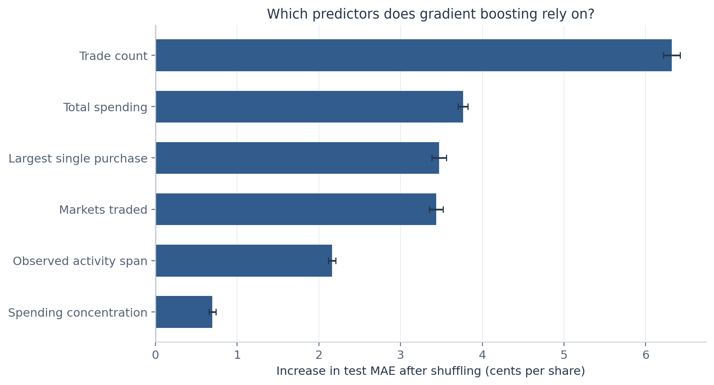

Figure 12. Gradient boosting on test wallets, 20 shuffles per predictor. Bars show mean increases in MAE and error bars show shuffle standard deviations. Correlated predictors can share or distort importance. Importance gives neither effect direction nor a causal effect.

Trade count produces the largest error increase at 6.32 cents. Total spending, largest purchase, and market count follow at roughly 3.4 to 3.8 cents. Observed span contributes less under this measure, while concentration has the smallest individual increase. Shuffling breaks relationships among correlated predictors, so the ranking is specific to this model and dataset.

| Linear model predictor | Price difference per training SD cents |
| --- | --- |
| Trade count | -18.44 |
| Largest single purchase | -1.21 |
| Spending concentration | -0.20 |
| Observed activity span | +2.45 |
| Markets traded | +9.92 |
| Total spending | +17.28 |

Linear coefficients describe conditional associations after the stated transformations. They do not show effect sizes for an intervention. Shared information among predictors and the additive form limit their substantive interpretation. The companion coefficient figure provides the same comparison visually.

## Sensitivity to predictor choice and price bounds

We prespecify a four-predictor sensitivity model using trade count, market count, observed span, and concentration. It removes total spending and largest purchase. Both boosting specifications receive the same six-candidate training-only search. This checks whether the main result relies heavily on monetary summaries computed from the same transactions as the target.

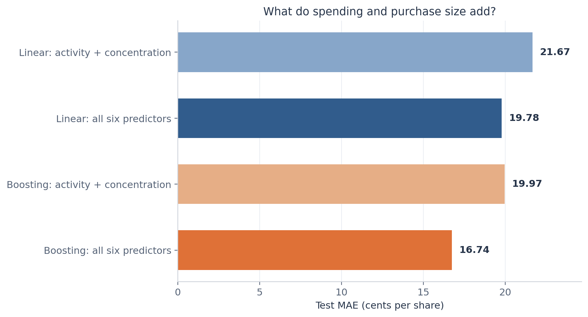

Figure 14. The four-predictor specification excludes total spending and largest purchase. Both boosting specifications use the same training-only tuning procedure. All inputs still summarize the same observed trading period.

With only activity and concentration, boosting MAE rises from 16.74 to 19.97 cents and R squared falls from 0.368 to 0.148. Monetary inputs therefore add predictive information in this sample. Activity-only boosting still improves on the mean and median constants. The exercise remains a prediction of same-period summaries because every input comes from the observed history.

### Alternative constant and bounded predictions

Because MAE is the primary metric, we also check a training-median baseline, the optimal constant for absolute loss. Its test MAE is 21.55 cents. Boosting improves on it by 22.3%, so the main result does not depend on choosing the less favorable mean constant.

| Model | Predictions outside zero to one | MAE after clipping cents |
| --- | --- | --- |
| Linear regression | 22 | 19.775 |
| Gradient boosting | 17 | 16.728 |

Only 22 linear predictions and 17 boosting predictions fall outside zero to one. Clipping changes the errors by less than one hundredth of a cent per share and preserves the ranking. We retain the original predictions for the primary comparison rather than choose a postprocessing rule using the test set.

## Variation across wallet groups and calibration

We compare errors for one-market wallets, wallets with zero observed activity span, and wallets meeting the demo high-activity rule. These are descriptive, overlapping groups. No group is removed or used to tune a new model. The high-activity group contains only 50 test wallets, so its apparent performance has limited precision.

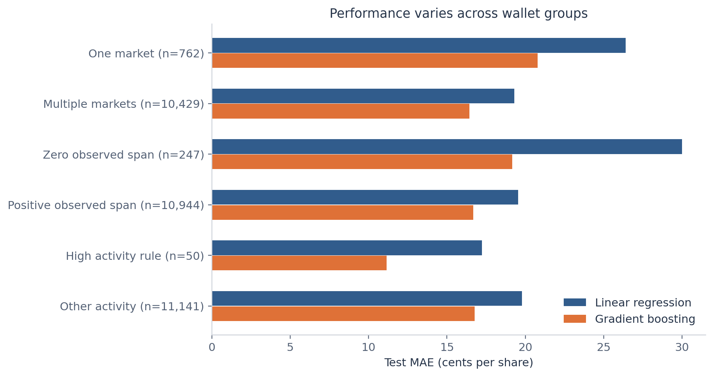

Figure 15. Test subgroups overlap. The high activity rule is at least 500 markets or 2,000 trades. Every group remains in model fitting. Small subgroups support limited precision.

Boosting MAE is 20.78 cents among the 762 one-market test wallets, compared with 16.44 cents among the 10,429 multi-market wallets. For the 247 wallets with zero observed span, it is 19.15 cents. These comparisons show that the pooled result can conceal differences in predictability across wallet histories.

### Average calibration

The separate calibration plot groups test wallets into ten approximately equal-frequency bins based on predicted price. It compares each bin's mean prediction with its mean observed price. Its intervals use standard errors of observed bin means under wallet independence. These summaries diagnose average alignment. They do not assess prediction-interval coverage or guarantee small errors for individual wallets.

The figure gallery contains the full calibration plot and its bin table. Diagnostic figures are used to describe the selected models. They do not trigger feature changes, additional tuning, or selection on the final test wallets.

## Interpretation and study limitations

The six wallet summaries contain useful information about average purchase price. The flexible model provides a meaningful gain over an additive linear specification on the fixed test split, consistent with predictive value in nonlinear patterns or interactions. The experiment does not isolate which specific interaction produces that gain.

### What the result describes

The target and monetary inputs summarize the same underlying trades. This is a legitimate comparison for reconstructing a wallet-level summary when those inputs are already available. Its value as an economic forecast would require predictors observed before the future target period. The current table cannot support that temporal design.

Wallets differ in which markets and outcomes they buy. Market mix and trading timing may explain some price variation, and neither is available in the aggregated table. Price alone cannot establish risk preference, prediction skill, profit, or access to private information. We make no claims about those outcomes.

### Where uncertainty remains

The sampled event groups and observation window constrain generalization. Wallets can share the same markets or respond to common news, and a person can control more than one wallet. Random wallet splitting does not test performance on entirely unseen markets or future events. The reported bootstrap treats wallets as independent and may understate uncertainty when errors are correlated.

The MAE intervals condition on one fitted set of models and one split. They exclude the variation from rebuilding training samples or searching different parameter grids. The grid contains only six boosting configurations and compares one linear specification. Conclusions apply to this benchmark rather than every possible linear or nonlinear model.

Predictor importance and coefficient signs depend on correlated inputs and model form. Permutation importance gives no direction of effect. The confirmed flag is excluded throughout, so the study neither detects insiders nor evaluates insider labels.

### A defensible presentation takeaway

Wallet activity and spending summaries predict part of the variation in average purchase price. Gradient boosting reduces held out MAE by 15.4% relative to linear regression, but a typical absolute error of about 16.7 cents leaves considerable individual uncertainty. The result describes associations within this selected historical cohort.

## Reproducibility and source record

The accompanying analysis script loads only the agreed eight columns, verifies data constraints, saves wallet split membership, makes training-only development figures, fits models with training-only validation, and then saves fixed test predictions and diagnostics. Analysis outputs do not contain or use the ignored flag.

| Reproduction setting | Value |
| --- | --- |
| Split and fold seed | 42 |
| Bootstrap and permutation seed | 2026 |
| Training folds | 5 shuffled folds |
| Bootstrap resamples | 2,000 paired wallet samples |
| Permutation repeats | 20 per predictor |
| Python | 3.12.14 |
| scikit learn | 1.7.2 |
| NumPy | 2.5.4 |
| pandas | 2.2.3 |
| Matplotlib | 3.10.7 |

To reproduce the analysis, install code/requirements.txt in a Python 3.12 environment and run code/analyze_wallet_prices.py with --data pointing to the supplied CSV. The script writes results relative to its study folder. The source table remains unchanged. Saved fitted models are provided for reproducing predictions in the recorded package versions.

The main numeric records are tables/primary_model_metrics.csv, tables/all_model_metrics.csv, tables/paired_bootstrap_comparisons.csv, tables/cv_grid_full.csv, tables/test_predictions.csv, and tables/analysis_summary.json. Wallet split membership is in tables/wallet_split.csv. PNG figures support direct reuse and SVG figures preserve editable vector elements.

### Sources

[R1] Wallet feature table. Local course dataset at wallet_analysis/data/wallet_features.csv. SHA256 0a44686df51dc86a6f569e2f85867e6607f33bedffa521831b4767cbb8135c8a.

[R2] Course data definitions. L3 prediction markets student package, notebooks/insider_demo.ipynb, opening data description and feature dictionary. Used for cohort scope and variable definitions only. The insider detection task and its labels are outside this study.

[R3] [Gradient boosting implementation](https://scikit-learn.org/1.7/modules/generated/sklearn.ensemble.HistGradientBoostingRegressor.html)

[R4] [Cross validation](https://scikit-learn.org/1.7/modules/cross_validation.html)

[R5] [Permutation importance](https://scikit-learn.org/1.7/modules/permutation_importance.html)

[R6] [Preprocessing and leakage](https://scikit-learn.org/1.7/common_pitfalls.html)

## Figure index and presentation selection

The complete figure gallery includes every figure below, with full captions. The report emphasizes the figures that explain the pipeline and main conclusions. The four-slide presentation selects the target distribution, model error comparison, and permutation importance. Its approach slide explains the split and comparison without adding an introduction or closing slide.

| Figure | Content | Use |
| --- | --- | --- |
| 01 | Distribution of average purchase price | Presentation and report |
| 02 | Predictor distributions after transformation | Report or supplement |
| 03 | Rank correlations | Report or supplement |
| 04 | Observed price patterns by predictor | Report or supplement |
| 05 | Cross validation for gradient boosting | Report or supplement |
| 06 | Test prediction error | Presentation and report |
| 07 | Observed and predicted prices | Report or supplement |
| 08 | Residuals versus predicted price | Report or supplement |
| 09 | Distributions of prediction errors | Report or supplement |
| 10 | Binned calibration | Report or supplement |
| 11 | Prediction error by observed price group | Report or supplement |
| 12 | Permutation feature importance | Presentation and report |
| 13 | Standardized linear coefficients | Report or supplement |
| 14 | Sensitivity to monetary predictors | Report or supplement |
| 15 | Prediction error by wallet subgroup | Report or supplement |

All figure data and model diagnostics remain available in the tables folder. The presentation uses the same underlying values and model names as this report. Its editable charts preserve those values for reuse in the team presentation.
